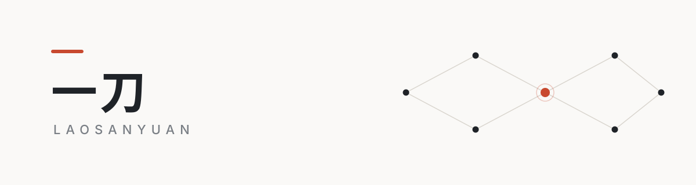

<p align="center">
  <picture>
    <source media="(prefers-color-scheme: dark)" srcset="./assets/banner-dark.svg">
    
  </picture>
</p>

### 一刀

杭州。主要写 C#/.NET，也在做 Flutter、Rust、Python 的跨端产品。

技术栈：C# · .NET · Flutter · Dart · Rust · Python · TypeScript · Vue

邮箱：[yhonglai@163.com](mailto:yhonglai@163.com)

---

### 历史项目

- **[HuoHuan](https://github.com/laosanyuan/HuoHuan)** — 微信群二维码抓取工具，299★，WPF + 插件化架构
- **[HamibotRemoteControl](https://github.com/laosanyuan/HamibotRemoteControl)** — Hamibot 远程控制客户端，37★
- **[fans_trunk](https://github.com/laosanyuan/fans_trunk)** — Telegram 频道互推机器人（互推车），Python + SQLite
- **[DaoLang](https://github.com/laosanyuan/DaoLang)** — .NET 多框架本地化库，Roslyn 源生成器，MIT

---

### GitHub 统计

<p align="center">
  <picture>
    <source media="(prefers-color-scheme: dark)"
            srcset="https://github-readme-stats.vercel.app/api?username=laosanyuan&amp;show_icons=true&amp;hide_border=true&amp;bg_color=00000000&amp;title_color=F0EFEA&amp;text_color=C9CCD1&amp;icon_color=E4694C">
    
  </picture>
  <picture>
    <source media="(prefers-color-scheme: dark)"
            srcset="https://github-readme-stats.vercel.app/api/top-langs/?username=laosanyuan&amp;layout=compact&amp;langs_count=8&amp;hide_border=true&amp;bg_color=00000000&amp;title_color=F0EFEA&amp;text_color=C9CCD1">
    
  </picture>
</p>

---

### WakaTime

<p align="center">
  
</p>

<!--START_SECTION:waka-->
```text
等待首次自动更新
```
<!--END_SECTION:waka-->
